# Prueba Tecnica - Ingeniero DevOps Banco Agricola

En el presente documento se muestra como se llevo a cabo la implementacion, se trato de hacer la mayor cantidad de cosas de manera automatizada, pero por ciertos temas, algunso toco hacerlos manuales por linea de comandos, esto por cuestion de tiempo

Durante la rubrica se solicitaban diferentes temas, entre estos:"
- IaC con TF para AWS modularizada
- Implementacion de Jenkins y Vault con VSO y CSI dentro de un cluster 
- Implementacion del aplicativo en otro cluster
- Desarrollo de pipeline de despliegue
- Aplicativo en java 21
- Administracion de K8s

Bajo esto se incorporan 3 repositorios de codigo, los los cuales se dividen de la siguiente manera

## Arquitectura
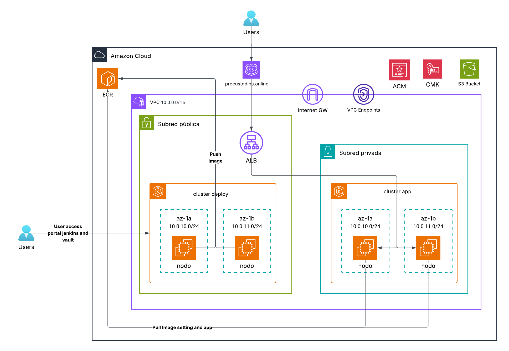

## Repositorios

### Repositorio IaC

Este repositorio contiene una nomenclatura de nombre semi estandarizada, y una estructura modular local, buscando que el archivo main tenga solamente la orquestacion de los modulos, de manera reutilizable

A su vez este se alojo en GitHub como decision, ya que no se mencionaba donde ubicar el codigo del aplicativo, se decidio llearlo a un repositorio remoto, y aprovehcando se utilizo GitHub Actions para el despliegue automatizado de la IaC ya que hasta ese momento aun no habia infra en AWS, esto con el objetivo de tener la mayor cantidad de cosas automatizadas

se presenta a continuacion la estructura de carpetas del repositorio

```bash
AW100002_IaCPruebaCusca_TF/
├── .github/
│   └── workflows/
│       ├── AW100002_IaCPruebaCusca_TF_CI.yml
│       └── AW100002_IaCPruebaCusca_TF_Destroy.yml
├── Infra/
│   ├── modules/
│   │   ├── ECR/
│   │   ├── EKS/
│   │   ├── IAM/
│   │   ├── KMS/
│   │   ├── Networking/
│   │   │   ├── internet-gateway/
│   │   │   ├── route-tables/
│   │   │   ├── subnets/
│   │   │   ├── VPC/
│   │   │   └── vpc-endpoints/
│   │   └── Security/
│   ├── backend.tf
│   ├── dev.tfvars
│   ├── main.tf
│   ├── output.tf
│   ├── prod.tfvars
│   ├── provider.tf
│   ├── qa.tfvars
│   └── variables.tf
├── .gitignore
└── README.md
```

cada modulo contiene la sigueinte estructura
```bash
module/
  ├── main.tf
  ├── output.tf
  └── variables.tf
```

Ademas se agrego dos CI uno automatico al hacer un push este permite el deploy de la infraestrutura, y uno para hacer destroy, este ultimo CI se ejecuta de manera manual para evitar algun problema, y se segrega del pipeline origil como estrategia y control de riesgo, a continuacion se presentan evidencias del despliegue automatizado

1. Action workflow 
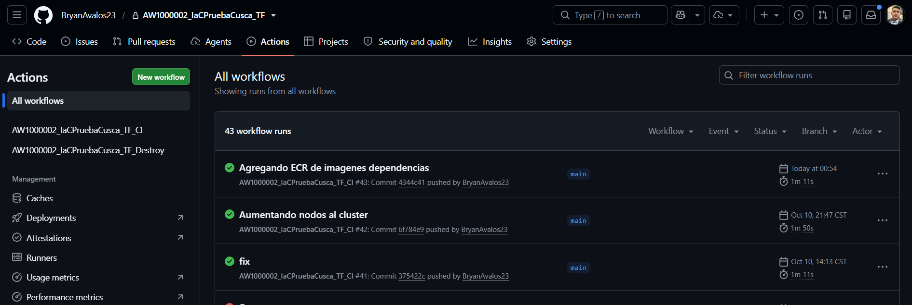

2. Flujo CI/CD de infraestructura por stages 
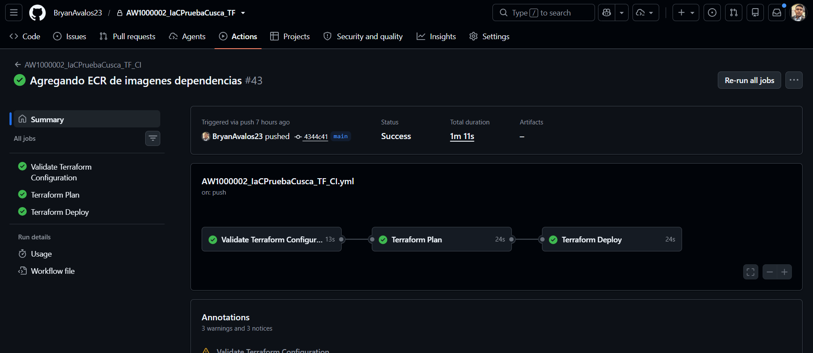

3. Ejecuciones por stage de flujos mas recientes
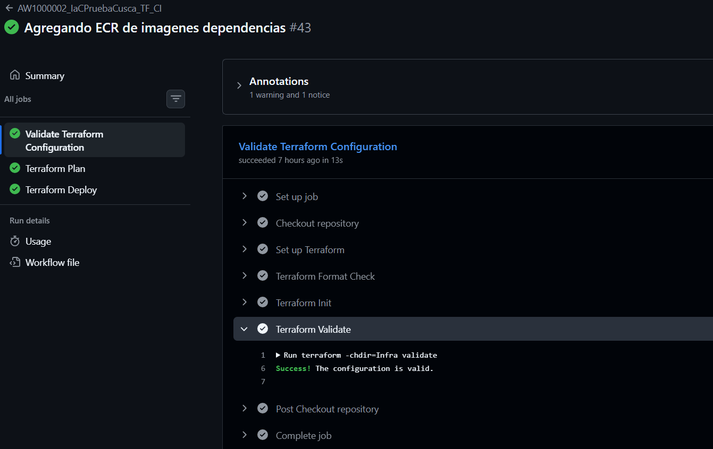

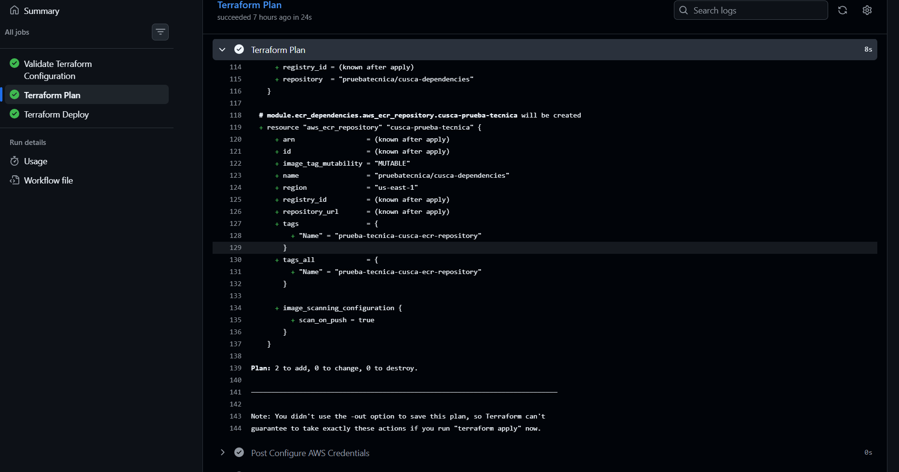

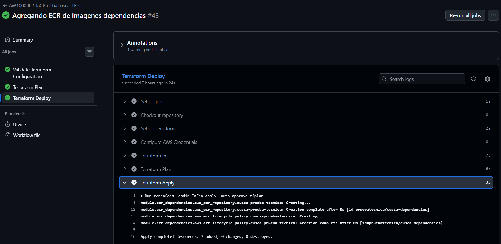

4. Se muestran algunos de los componentes creados en AWS

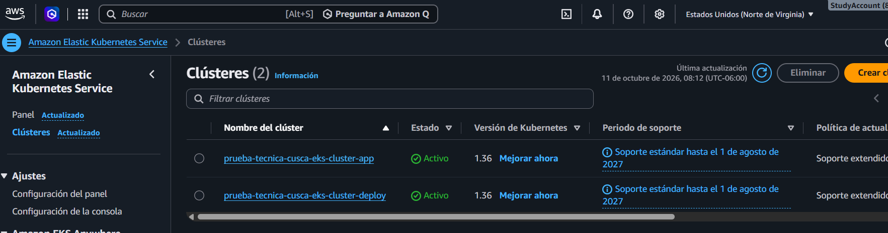

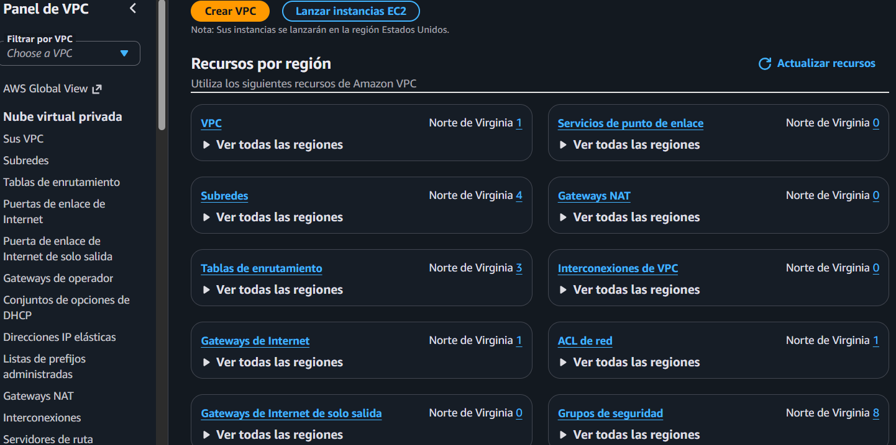

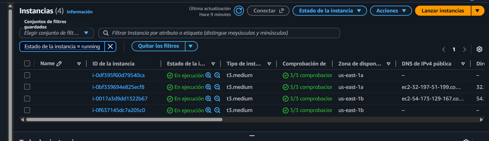

### Repositorio de configuraciones

Este repositorio se creo con la intencion de facilitar y tener mejor seguimiento de los procesos necesarios de configuracion del cluster de despliegue, contiene manifiestos, scripts y otros archivos para configuracion tanto automatizada en pipeline como manual para hacer ejecuciones desde terminal

Este repositorio esta ubicado en GitHub y contiene su respectivo actions, con trigger manual para seleccionar que pase se desea ejecutar, al inicio se dejo automatico todo, pero por decision y estrategia se dejo con ejuecucion de seleccion manual de stage. El flujo recomendado para este es:
- Vault
- Jenkins
- VSO
- Buildkit

La idea es desplegar la base de Vault, jenkins, configurar credenciales y validar conexion, luego de eso implementar VSO y si hay pasos extras, ejecutar manualmente desde terminal comandos para aplicacion de maifiestos o validaciones extras, por ultimo ejecuctar la instalacion del Buildkit para el el build de docker

Se muestra a continuacion algunas ejecuciones del pipeline

1. Vista del actions
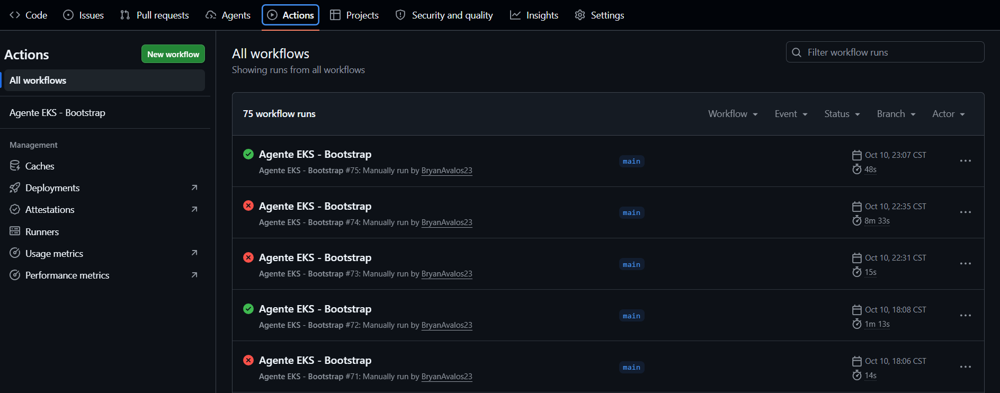

2. Implementacion principal automatica (se migro a seleccion manual de stage)
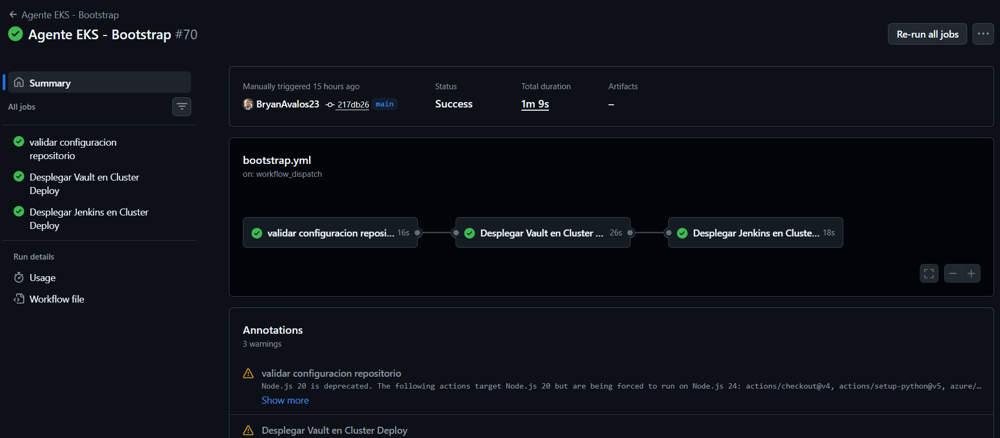

3. Seleccion de ejecucion por stage
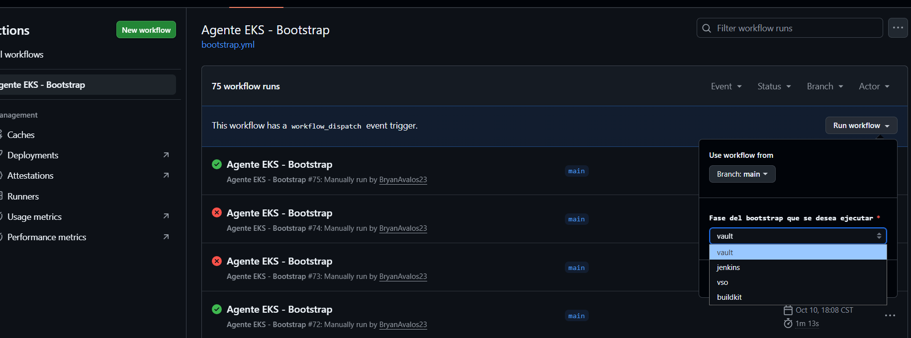

4. Ejecucion por stage deseado - buildkit
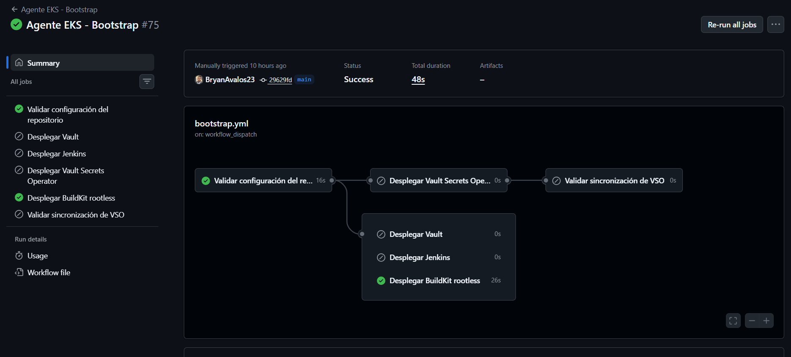

5. Validacion de pods
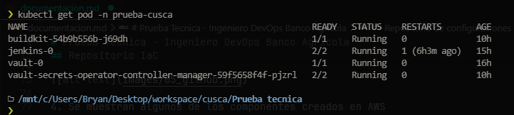

### Repositorio de aplicativo

Este repositorio contiene una app sencilla en java 21 con maven, este disponibiliza 3 endpoints que son los siguientes:
- http://k8s-demoserv-demoserv-069eb8ba89-304355471.us-east-1.elb.amazonaws.com/actuator/health/readiness
- http://k8s-demoserv-demoserv-069eb8ba89-304355471.us-east-1.elb.amazonaws.com/api/config
- http://k8s-demoserv-demoserv-069eb8ba89-304355471.us-east-1.elb.amazonaws.com/api/secret

Cada uno proporciona el dato segun lo indicado en la prueba, este repositorio contiene
- manifiestos helm
- Dockerfile
- Jenkinsfile para el pipeline
- manifiestos de plataforma (alb controller, metric server, etc)
- Aplicativo en java

este aplicativo requiere una variable(un secreto como se indica en la prueba) y que se inyecte desde el pipeline, y luego se muestre, asi como informacion de configuracion y el health check, para iniciarlo, este ya trae su wrapper, solo se requiere ejecutar:

- hacer un build de la imagen
  ```bash
  docker build -t imagetest:latest .
  ```
- correr laimagen paramterizando un valor en APP_SECRET
  ```bash
  docker run --rm -e APP_SECRET="local-test-123" -p 8081:8081 imagetest:latest
  ```

esto para pruebas en local del funcionamiento de este, ahora para desplegar en k8s se configuraron sus respectivos manifiestos
- deployment
- ingress
- service
- HPA (quedo pendiente por tiempo)
- values(values, values-environment)

## configuracion para el despliegue
Para cada caso se configuro lo necesario, donde se icorporaron roles de depsliegue con los permisos necesarios sieguiendo el principio de OIDC Provider para poder tener acceso restringid solo al proveedor o servicio, asi como para el despliegue de la infraestructura se dejo lo que es un Bucket S3 para el almacenamiento del backend de la IaC

1. Creacion de Bucket proposito general
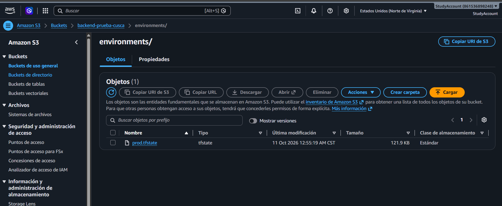

2. configuracion de proveedor de identidad
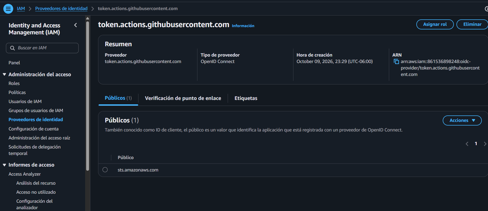

3. Rol de despliegue OIDC (IaC)
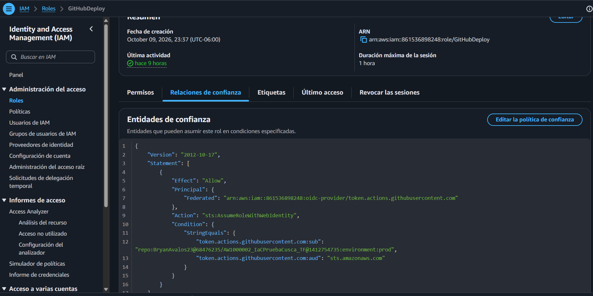

4. Rol de despliegue OIDC (Settings)
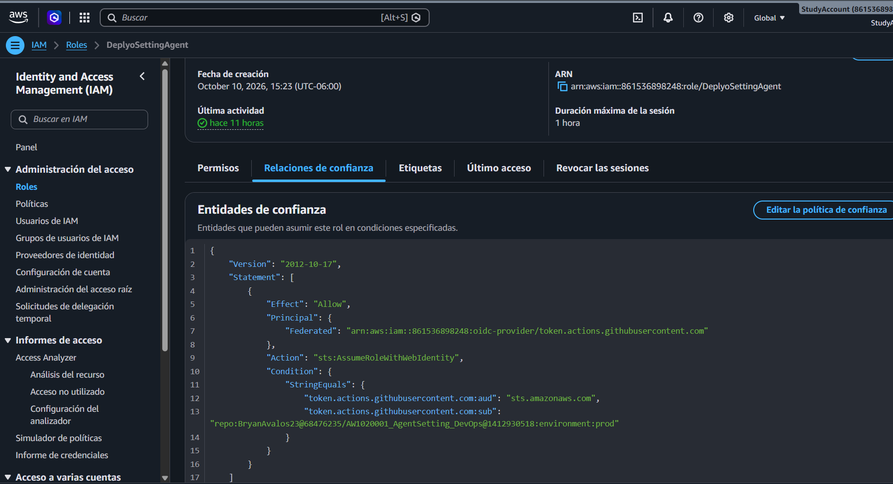

5. configuracion de credenciales de acceso en github
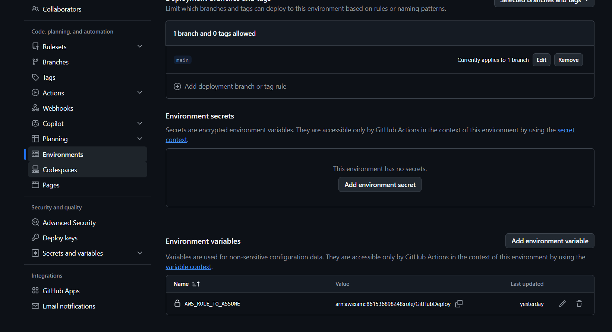

6. Para el login a AWS se agrega esta tarea en el pipeline
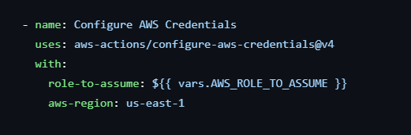

## Despliegue de aplicativo y configuracion de jenkins y vault inicial

Se adjunta un documento de word con las capturas del paso a paso, de las configuracion de vault y jenkins, antes de implementar VSO y validar conexion, este esta en el apartado **docs**, ahi tambien se vera las imagenes de componentes en cluster de aplicativo y los resultados accediendo a las rutas

Comentarios:

Algunas cosas no se lograron agregar por tiempo, y algunas tareas y proedimientos no se incorporaron en manifiestos sino que se fueron ejecutando a medida era necesario, asi como las capturas de pantalla de acceso por dominio a los endpoint por tardansa en verificacion pero queda el dominio listo y solo se valide sera accesible

Se trato de automatizar la mayor cantidad de cosas pero algunas no se lograron y se hicieron a mano, en esto es por eel R53 y ACM 

Se cargaron tambien imagenes a un registry adicional que se creo para el cluster privado tuviera las imagenes requeridas, por ejemplo, alb controller, server metrics, entre otra necesidad

No se incorporo diagrama del flujo CI/CD por tema de tiempo lastimosamente